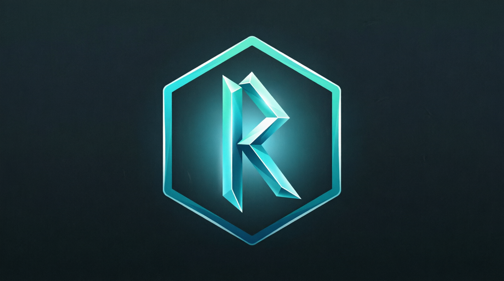

<p align="center">
  
</p>

<h1 align="center">RuneCast</h1>

<p align="center">
  <a href="https://github.com/davidharputoglu/RuneCast/actions/workflows/tests.yml"></a>
</p>

<p align="center">
  <b>Traduction de jeux vidéo pour Windows et Linux</b><br>
  <i>Video game translation for Windows and Linux</i>
</p>

<p align="center">
  Créé par HARPUTOGLU David, aidé par l'IA · Contact : kasparof57@gmail.com<br>
  Logiciel libre sous licence GPLv3 ou ultérieure
</p>

> 🇬🇧 English version below: [English](#english)

---

## 🇫🇷 Français

### Qu'est-ce que RuneCast ?

RuneCast est un logiciel libre qui traduit les jeux vidéo, pour que chacun puisse lire et comprendre ses jeux dans sa langue. La première version vise les jeux **Ren'Py** (romans visuels).

### État du projet

🚧 **En cours de développement : rien n'est encore utilisable.** Le développement suit un plan en 51 étapes, chacune testée sur Windows 10 et Fedora 44 avant de passer à la suivante :

- [Plan de développement](docs/PLAN-V1.md)
- [Suivi des étapes](docs/SUIVI-ETAPES.md)

### Ce que fera la version 1.0

- Traduction des jeux Ren'Py : dialogues, menus, interface du jeu, descriptions.
- Traduction **en ligne** (Yandex en premier, Google, DeepL et d'autres) ou **100 % sur le PC**, sans internet.
- Glossaires par jeu, protection automatique des balises et des variables, cache des traductions.
- Sauvegarde automatique des fichiers originaux du jeu et restauration en un clic.
- Interface en 15 langues, dont 8 langues turciques et l'arabe (de droite à gauche), avec des thèmes personnalisables.
- Fonctionne sur un PC modeste : 8 Go de RAM, sans carte graphique dédiée.

### Organisation des dossiers

```
RuneCast/
├── .github/
│   └── workflows/         Tests automatiques sur GitHub (Windows, Ubuntu, Fedora)
├── assets/
│   ├── branding/          Logo de l'application (image d'origine et version carrée)
│   └── icons/             Icônes Windows (.ico), Linux (PNG) et favicon
├── docs/
│   ├── PLAN-V1.md         Plan de développement validé
│   ├── SUIVI-ETAPES.md    Avancement, étape par étape
│   └── projet/            Cahier des charges et checklist de vérification
├── src/
│   └── runecast/          Code source de l'application
│       ├── resources/     Fichiers embarqués (icônes, polices, thèmes, traductions compilées)
│       └── ui/            Interface graphique (fenêtres, thème)
├── tests/                 Tests automatiques
├── tools/                 Outils de développement (icônes, traductions…)
├── translations/          Traductions de l'interface (fichiers .ts)
├── CHANGELOG.md           Journal des versions
├── LICENSE                Texte officiel de la licence GPLv3
├── pyproject.toml         Fiche d'identité du projet Python
└── README.md              Ce fichier
```

### Pour les développeurs

Il faut [Git](https://git-scm.com/) et [uv](https://docs.astral.sh/uv/). Sur Fedora, installer aussi `python3.13`.

```bash
git clone https://github.com/davidharputoglu/RuneCast.git
cd RuneCast
uv run pytest            # lance les tests automatiques
uv run runecast          # ouvre RuneCast
uv run runecast --version
uv run runecast --paths  # affiche les dossiers de données
uv run runecast --portable  # mode portable (données dans portable-data/)
```

Sous Linux, `uv run python tools/install_desktop_entry.py` ajoute RuneCast au menu des applications, pour que le dock affiche son icône.

Pour mettre à jour les traductions après avoir changé des textes : `uv run python tools/update_translations.py`, puis traduire les nouveaux textes dans `translations/*.ts` (par exemple avec `uv run pyside6-linguist`).

Chaque fichier de code commence par l'en-tête de licence GPLv3 (voir `src/runecast/__init__.py`). Un test vérifie automatiquement que personne ne l'oublie. Les commentaires du code sont rédigés en français et en anglais.

### Licence

RuneCast est distribué sous la **GNU General Public License version 3, ou (à votre choix) toute version ultérieure** (voir [LICENSE](LICENSE)).
Vous êtes responsable du respect des conditions d'utilisation des jeux que vous traduisez.

---

## English

### What is RuneCast?

RuneCast is free software that translates video games, so that everyone can read and understand their games in their own language. The first version targets **Ren'Py** games (visual novels).

### Project status

🚧 **Under development: nothing is usable yet.** Development follows a 51-step plan (in French), each step tested on Windows 10 and Fedora 44 before moving on:

- [Development plan](docs/PLAN-V1.md)
- [Step tracking](docs/SUIVI-ETAPES.md)

### What version 1.0 will do

- Translate Ren'Py games: dialogue, menus, in-game interface, descriptions.
- **Online** translation (Yandex first, Google, DeepL and others) or **100 % on the PC**, without internet.
- Per-game glossaries, automatic protection of tags and variables, translation cache.
- Automatic backup of the original game files and one-click restore.
- Interface in 15 languages, including 8 Turkic languages and Arabic (right-to-left), with customizable themes.
- Runs on modest PCs: 8 GB of RAM, no dedicated graphics card.

### For developers

You need [Git](https://git-scm.com/) and [uv](https://docs.astral.sh/uv/). On Fedora, also install `python3.13`.

```bash
git clone https://github.com/davidharputoglu/RuneCast.git
cd RuneCast
uv run pytest            # runs the automatic tests
uv run runecast          # opens RuneCast
uv run runecast --version
uv run runecast --paths  # prints the data folders
uv run runecast --portable  # portable mode (data in portable-data/)
```

On Linux, `uv run python tools/install_desktop_entry.py` adds RuneCast to the application menu so the dock shows its icon.

Every source file starts with the GPLv3 license header (see `src/runecast/__init__.py`), and a test makes sure nobody forgets it. Code comments are written in both French and English.

### License

RuneCast is distributed under the **GNU General Public License version 3, or (at your option) any later version** (see [LICENSE](LICENSE)).
You are responsible for respecting the terms of use of the games you translate.

Created by HARPUTOGLU David, assisted by AI · Contact: kasparof57@gmail.com
